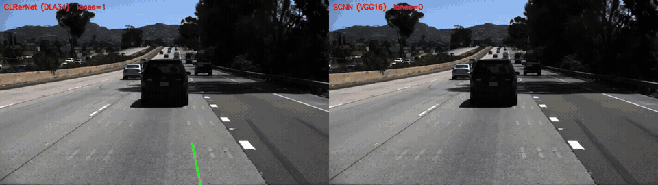

# CULane Lane-Detection Benchmark & Robustness Study

[](https://github.com/AhireRohit/lane_detection_CuLane/actions/workflows/ci.yml)

**[Live demo](https://lanedetectionculane.streamlit.app/)**: upload a dashcam image or short video, or try a built-in sample. Run CLRerNet (pretrained or our robust fine-tune), UFLDv2 or SCNN on a free CPU in the browser, side by side. The first visit after a restart takes a few minutes to set up. Code: [`streamlit_cloud/`](streamlit_cloud/).
**[Model page](https://huggingface.co/spaces/roh24/culane_lane_detection)** for the robust CLRerNet checkpoint: recipe, results, limits and download.

A reproducible benchmark of three **pretrained** lane detectors on the full CULane test set, run on an HTCondor GPU cluster. It covers:
- reproducing the published accuracy;
- a single, shared evaluation protocol;
- same-hardware speed;
- a corruption-robustness study;
- dashcam video tests;
- a temporal lane tracker with a controlled ablation;
- corruption-augmented fine-tuning of CLRerNet, compared against a same-schedule control;
- a cross-dataset test on TuSimple, the tracker's accuracy on labeled video, and ONNX/INT8 CPU deployment (v5).

| Model | Code | Checkpoint |
|---|---|---|
| SCNN (VGG16) | [delldu/SCNN](https://github.com/delldu/SCNN) @ `a6fadfb`, a PyTorch port of the Torch7 original | converted official weights |
| Ultra-Fast-Lane-Detection-v2 (ResNet34) | [cfzd/Ultra-Fast-Lane-Detection-v2](https://github.com/cfzd/Ultra-Fast-Lane-Detection-v2) @ `c903880` | `culane_res34.pth` |
| CLRerNet (DLA34, EMA) | [hirotomusiker/CLRerNet](https://github.com/hirotomusiker/CLRerNet) @ `dae038f` | `clrernet_culane_dla34_ema.pth` (v0.1.0) |

The pretrained weights are the authors'. This project's work is everything built around them: evaluation, benchmarking, diagnosis, robustness testing, video adaptation, post-processing and fine-tuning.

## Results

### Accuracy (CULane test, 34,680 images, official C++ evaluator, IoU 0.5)

| Model | Published F1 | Reproduced F1 |
|---|---|---|
| SCNN | 71.6 | 70.07 |
| UFLDv2, with TTA (author default) | 76.0 | 75.98 |
| UFLDv2, without TTA | 75.9 | 75.86 |
| CLRerNet | 81.55 | 81.55 |

Per-scenario results with the published values (checked against the papers' tables) are in `reports/culane_by_scenario.csv` and `reports/published_by_scenario.csv`. SCNN's 1.5-point gap is concentrated in the shadow and night scenarios.

### Speed (one Tesla P100, batch 1, FP32, 200 timed frames after 50 warmup frames)

| Model | Forward pass, median | Full prediction, median | FPS |
|---|---|---|---|
| SCNN | 51.0 ms | 63.9 ms | 15.7 |
| UFLDv2 | 11.7 ms | 53.3 ms | 18.8 |
| CLRerNet | 14.2 ms | 20.7 ms | 48.3 |

UFLDv2's network is fast, but preprocessing and the per-point Python decode dominate its end-to-end time. CLRerNet's deterministic-cuBLAS setting (`CUBLAS_WORKSPACE_CONFIG`) costs about 3.5 ms per frame, measured with an off/on/off A/B test.

### Robustness (2,895 test images × 5 corruptions × 3 severities; identical inputs for all models)

| | SCNN | UFLDv2 | CLRerNet |
|---|---|---|---|
| Clean F1 | 69.8 | 76.0 | 81.7 |
| Mean F1 over 15 corrupted conditions | 56.1 | 64.4 | 72.6 |
| Share of clean F1 kept | 80% | 85% | 89% |

Rain and heavy motion blur are the most damaging corruptions. Heavy JPEG compression (quality 5) is the only condition where CLRerNet does not lead.

### Corruption-augmented fine-tuning (CLRerNet, 3 epochs from the released checkpoint)

Runs with identical settings except for augmentation:
- the **control** uses the authors' training recipe;
- the **corruption** run adds one random corruption (rain, motion blur, JPEG or darkening) to half of the training images;
- the **broad** run instead adds one of 7 corruption types that never appear in the test set.

The shadow corruption was never trained on. The last-epoch checkpoint was used, with no selection, and the test set was scored once.

Control and corruption runs: mean ± standard deviation over 3 seeds.

| | Original | Fine-tuned control | Fine-tuned with corruptions | Broad augmentation (1 seed) |
|---|---|---|---|---|
| CULane test F1 (34,680 images) | 81.55 | 81.27 ± 0.10 | 81.23 ± 0.05 | 81.32 |
| Mean F1 over 15 corrupted conditions | 72.56 | 70.17 ± 0.15 | **77.44 ± 0.11** | 71.32 |
| Share of clean F1 kept | 88.8% | 86.4% | **95.5%** | 87.8% |
| Heavy rain (1,500 streaks) | 46.41 | 38.69 ± 0.33 | **77.38 ± 0.32** | 37.44 |
| JPEG quality 5 | 47.83 | 39.18 ± 0.78 | **64.15 ± 0.17** | 45.37 |
| Motion blur 25 px | 55.92 | 52.18 ± 0.08 | 60.55 ± 0.59 | **62.93** |
| Shadow, mean of 3 severities (never trained on) | 81.25 | 80.78 ± 0.06 | 80.73 ± 0.04 | 80.88 |

- **Corruption training gives a large, reproducible gain on the corruption families it trains on:** +4.9 mean F1 over the original, and heavy rain +31.
- **Clean accuracy:** it costs nothing measurable against the control (−0.04 test F1). The 0.3 drop from the original comes from fine-tuning itself.
- **Broad augmentation** with 7 different corruption types (fog, snow, glare, noise, low contrast, colour cast) transfers only partly to unseen ones: motion blur +4.3 and JPEG +2.3, but rain −1.2 and shadow unchanged.

Details: §7.1–7.2 of the report and `reports/finetune_seeds.csv`.

### Cross-dataset test: TuSimple (never trained on)



*CLRerNet (left) and SCNN (right) on three unseen TuSimple test clips, through the demo's own pipeline. SCNN finds no lanes; CLRerNet finds most of them but misses some in the shaded first clip. Clips: TuSimple lane benchmark, via the Hugging Face mirror `dotblue/TuSimple`.*

233 test clips: the complete ones in the public 10% mirror. The whole frame is resized to the CULane shape, rows below y = 330 are scored, and the metric is the official TuSimple metric. Mean ± sd over 3 seeds for the fine-tunes.

| Model | TuSimple F1 [95% CI] | FN rate |
|---|---|---|
| SCNN | 0.0 | 100% |
| UFLDv2 | 65.2 [61.3–69.1] | 39% |
| **CLRerNet, released** | **68.0 [64.8–71.1]** | 41% |
| CLRerNet, control fine-tune | 62.5 ± 1.6 | 50% |
| CLRerNet, corruption fine-tune | 58.2 ± 0.7 | 54% |

- **All models miss many lanes on an unseen dataset.** SCNN fails almost completely, which was confirmed with a second, independent pipeline.
- **The corruption fine-tune's robustness does not transfer:** it scores 4.3 F1 below its own same-schedule control on every seed pair. Both fine-tunes score below the released model, so extra CULane training costs generalisation.

### Dashcam video and temporal tracking

- **Video adapter:** squashing 16:9 video into CULane's 2.78:1 shape distorts geometry. An aspect-preserving crop adapter, placed by matching vanishing points, reduces lane-count flicker for all three models.
- **Temporal tracker:** a causal tracker with matching, EMA smoothing and short dashed holds halves lane re-starts for SCNN and CLRerNet and reduces jitter for all three models, at under 1 ms per frame.
- **Tracker accuracy on labeled video (v5):** on TuSimple clips at 20 fps it raises CLRerNet's F1 by **+3.4** (paired 95% CI 1.6 to 5.2). For UFLDv2 and SCNN the change is not significant. On CULane, whose frames are 1 s apart, it costs 16–20 F1, because it is built for consecutive video frames.
- **Geometry filter:** tested with three calibrations and not adopted, because it removed real lanes.

### CPU deployment: ONNX and INT8 (CLRerNet)

| | PyTorch FP32 | ONNX FP32 | ONNX INT8 |
|---|---|---|---|
| Forward pass, 4 CPU threads (Xeon E5-2690 v4) | 224 ms | **156 ms** | 223 ms |
| CULane test F1 | 81.55 | **81.55** | 67.92 |

- **ONNX FP32:** the same test result as the GPU run (identical TP/FP/FN), 1.4× faster than PyTorch on CPU.
- **Post-training INT8 (MinMax calibration, lane head kept in FP32):** no faster on this CPU, which lacks int8 (VNNI) instructions, and loses 13.6 F1. With every layer quantised, F1 drops to 0. It is not used.

Full write-up: [`reports/FINAL_REPORT.md`](reports/FINAL_REPORT.md).

## Demo apps

**Public demo** (`streamlit_cloud/`, [live](https://lanedetectionculane.streamlit.app/)): Streamlit Community Cloud, free CPU, any Python version.
- On first start, the app builds the models' own pinned Python 3.11 environment with `uv`, clones the model code at the pinned commits, and downloads and sha256-checks the checkpoints.
- Each model runs in a persistent worker process, so after the first run an image takes about 1 s.
- When several models are picked, it shows them side by side.
- `streamlit_cloud/ci_smoke.py` runs the same setup and inference in CI.

**Cluster demo** (`app/`): `app/streamlit_app.py` is a small web app:
1. Pick one or more models: CLRerNet, the robust fine-tuned CLRerNet, UFLDv2 or SCNN.
2. Upload a dashcam image or video.
3. Click **Generate**.

The app shows the detected lanes drawn on the image or video, with download buttons and per-model statistics. Inference runs on a cluster GPU through HTCondor (`jobs/app/infer.sub` → `scripts/app_job.sh` → `scripts/app_infer.py`), using the same model code as the benchmark, the vanishing-point crop adapter and, for videos, the temporal tracker. Your machine only needs SSH key login to the cluster and, ideally, `ffmpeg`.

```bash
pip install -r app/requirements.txt
cp app/settings.example.json app/settings.json   # fill in your login and the remote benchmark_culane path
streamlit run app/streamlit_app.py
```

On Windows, double-click `app\run_app.bat` instead: it starts the app and opens it in your browser.

Uploaded media have no labels, so the app shows detections and stability statistics, not accuracy.

## Tests and CI

GitHub Actions (`.github/workflows/ci.yml`) runs on every push:
- **unit tests** (`tests/test_core.py`): the TuSimple metric, the tracker's confirm/hold/smoothing rules, the CPU port of CLRerNet's lane NMS (including equality with the CUDA-verified version), and lane file I/O;
- **an end-to-end smoke test of the public demo on Python 3.14**, as on Streamlit Cloud: real setup, two CLRerNet checkpoints, model reuse and a page render.

## Repository layout

| Path | Contents |
|---|---|
| `scripts/` | evaluation, speed, robustness, dashcam, ablation, calibration, fine-tune and helper scripts |
| `config/`, `configs_ft/` | UFLDv2 test configs and CLRerNet fine-tuning configs |
| `jobs/` | HTCondor submit-file templates and the fine-tune evaluation DAG |
| `reports/` | result tables (CSV/JSON) and the full report |
| `patches/` | notes on every environment fix and correction, with evidence |
| `app/` | Streamlit demo app and its cluster backend |
| `streamlit_cloud/` | public demo (Streamlit Community Cloud) and its CI smoke test |
| `tests/`, `.github/` | unit tests and CI |

## Reproducing

**[REPRODUCE.md](REPRODUCE.md)** goes step by step from a fresh clone to every number in the report, with commands, run times and expected values. In short:

```bash
./setup_paths.sh /absolute/path/to/Lane_Detection   # this repo sits in Lane_Detection/benchmark_culane, CULane in Lane_Detection/datasets/CULane
bash scripts/bootstrap.sh                          # model repos at the pinned commits (checked), dataset link, dataset audit
bash scripts/download_weights.sh                   # author checkpoints, verified against config/checkpoints.sha256
condor_submit jobs/smoke5/smoke5.sub               # 5-image smoke test for all three models, then see REPRODUCE.md
```

Environment: `pytorch/pytorch:2.3.1-cuda12.1-cudnn8-devel` with one venv per model, built by `scripts/gpu_entry.sh` on the first GPU job. CLRerNet uses MMDetection 3.3.0 and MMCV 2.1.0, compiled for the GPU in the job (sm_60 on the P100s used here). The exact package versions are in `reports/environment_manifest.json`.

## Not included

- **CULane data and images:** the licence forbids redistribution.
- **Model weights:** download them from the authors. The robust fine-tune (seed 0) is hosted on the [model page](https://huggingface.co/spaces/roh24/culane_lane_detection); the other fine-tunes can be recreated by rerunning the fine-tune.
- **Vendor code:** it's pinned by commit and was never modified.

## Licence

The code and documentation in this repository are released under the [MIT License](LICENSE). The dataset, the model weights and the referenced model repositories keep their own licences.

## Acknowledgements

SCNN (Pan et al., AAAI 2018), Ultra-Fast-Lane-Detection-v2 (Qin et al., TPAMI 2022), CLRerNet (Honda & Uchida, WACV 2024), and the CULane dataset.
